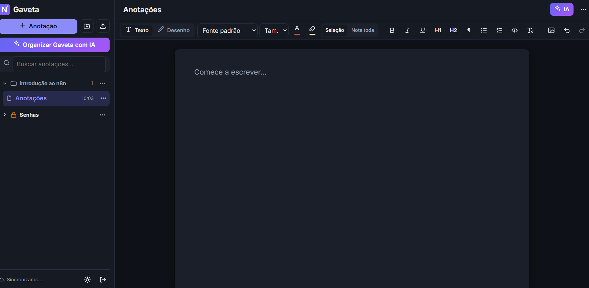
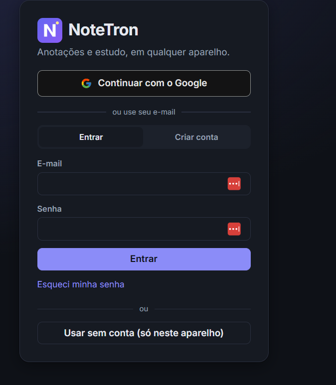
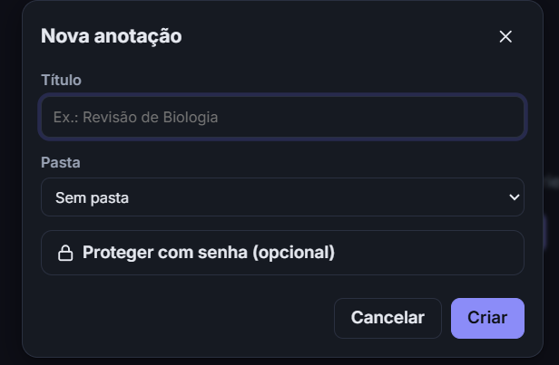
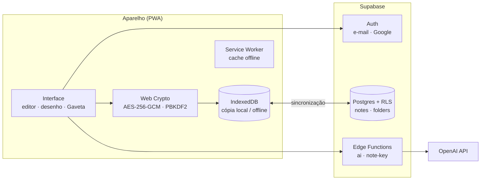

<div align="center">


# NoteTron

**App de anotações e estudo para computador e celular, com criptografia de ponta a ponta, desenho livre, blocos de código inteligentes e IA.**


</div>

---

## Sobre

O NoteTron é um **Progressive Web App**: funciona no navegador, pode ser instalado como aplicativo no Windows, macOS, Android e iPhone, e continua funcionando **offline**. As anotações ficam salvas no aparelho e sincronizam com a nuvem quando há conexão.

O projeto foi feito **sem framework e sem etapa de build**, em JavaScript moderno com módulos ES nativos, para manter o código direto e fácil de ler.

## Telas

<p align="center">
  
</p>

<table>
  <tr>
    <td width="50%"></td>
    <td width="50%"></td>
  </tr>
  <tr>
    <td align="center"><sub>Login com Google ou e-mail</sub></td>
    <td align="center"><sub>Nova anotação com pasta e senha opcional</sub></td>
  </tr>
</table>

## Funcionalidades

**Editor**
- Texto rico: fontes, tamanhos, cor da fonte e de fundo, negrito, listas e títulos. A formatação vale para o trecho selecionado ou para a nota inteira.
- **Blocos de código** com destaque de sintaxe (Python, JavaScript, TypeScript, C#, HTML e CSS) e um assistente no estilo VS Code:
  - autocompletar com prévia em cinza, aceito com <kbd>Tab</kbd>;
  - snippets (`def`, `for`, `class`, `log`, tags HTML…);
  - fechamento automático de `() [] {} "" ''` e de tags HTML;
  - indentação automática no Enter e <kbd>Shift</kbd>+<kbd>Tab</kbd> para desindentar;
  - blocos que podem ser arrastados para reordenar.
- **Modo desenho**: caneta, borracha, linhas, setas e formas (retângulo, elipse, triângulo, losango, hexágono, estrela).
- **Imagens**: colar, enviar ou arrastar; redimensionar; recortar ou contornar com uma forma; controlar camadas, inclusive "atrás do texto".
- Desfazer e refazer, tema claro e escuro, exportação para PDF.

**Organização**
- **Gaveta** com pastas, busca e arrastar-e-soltar.
- Importação de arquivos `.md`, `.txt` e de código.
- **Baixar pasta como ZIP**, com cada anotação convertida em PDF.

**Segurança**
- Senha por anotação e por pasta, com **criptografia no próprio aparelho**.
- Recuperação de senha por **código ou link enviado ao e-mail**.
- Trancamento automático ao sair da anotação ou da pasta, ou após 1 minuto com o app em segundo plano.
- Login por e-mail e senha (com confirmação por código) ou com o **Google**.

**IA** (OpenAI, liberada por conta)
- Organizar, formatar, resumir, corrigir e gerar perguntas de estudo a partir de uma anotação.
- Sugerir pastas e títulos para organizar a Gaveta inteira.

## Arquitetura



| Camada | Tecnologia |
|---|---|
| Interface | HTML, CSS e JavaScript (módulos ES), sem framework |
| Offline | Service Worker + IndexedDB (salva primeiro no aparelho e sincroniza depois) |
| Backend | Supabase: Postgres com Row Level Security, Auth e Edge Functions (Deno/TypeScript) |
| Criptografia | Web Crypto API (AES-256-GCM, PBKDF2-SHA256 com 310 mil iterações, HKDF) |
| IA | OpenAI (`gpt-4o-mini`), chamada só pelo servidor |
| Bibliotecas (CDN) | supabase-js, highlight.js, DOMPurify, marked, jsPDF, html2canvas, JSZip |
| Hospedagem | Qualquer host estático com HTTPS (ex.: Cloudflare Pages) |

## Modelo de segurança

- **Isolamento por usuário:** todas as tabelas usam *Row Level Security*. Cada conta só lê e altera os próprios registros.
- **Criptografia no aparelho:** cada anotação protegida tem uma chave aleatória (AES-256-GCM).
  - Essa chave é cifrada pela senha da anotação (PBKDF2) ou pela chave da pasta.
  - A chave da pasta é cifrada pela senha da pasta.
  - O servidor só recebe dados cifrados.
- **Recuperação por e-mail:** uma cópia da chave fica guardada cifrada com um segredo que só a Edge Function `note-key` conhece. Ela só é devolvida se a sessão atual foi confirmada por código ou link de e-mail nos últimos 15 minutos.
- **Segredos fora do código:** a chave da OpenAI, a chave `service_role` e o `RECOVERY_SECRET` existem só nos *secrets* das Edge Functions. O app no navegador conhece apenas a URL do projeto e a chave **anon**, que são públicas por definição: a chave anon só permite o que as regras de RLS autorizam.
- **IA por permissão:** as contas com acesso à IA ficam na tabela `app_admins`, que só o servidor lê.
- **Conteúdo sanitizado:** todo HTML colado, importado ou gerado pela IA passa pelo DOMPurify.

> Os títulos das anotações e os nomes das pastas não são criptografados: eles aparecem na lista. Pastas trancadas escondem os títulos das anotações de dentro.

## Estrutura

```
web/                      app (arquivos estáticos, publicados como estão)
  index.html  css/  icons/  sw.js  manifest.webmanifest
  js/
    app.js                orquestração: login, Gaveta, senhas, IA, ZIP/PDF
    editor.js             texto rico e blocos de código
    autocomplete.js       assistente de código (sugestões, snippets, pares)
    objects.js            camada de imagens, formas e desenho
    crypto.js             criptografia (Web Crypto)
    store.js / db.js      sincronização (IndexedDB ⇄ Supabase)
    config.js             URL e chave pública (anon) do Supabase
supabase/
  migrations/             tabelas, RLS e restrições
  functions/ai/           IA (OpenAI)
  functions/note-key/     recuperação de chaves por e-mail
  templates/              e-mails com código + link
```

## Rodar localmente

```bash
npx http-server web -p 5173 -c-1
```

Abra http://localhost:5173. Para testar sem backend, use **"Usar sem conta"**: tudo fica salvo só no navegador.

## Usar com o seu próprio Supabase

1. **Banco:** crie um projeto no Supabase e aplique, em ordem, os arquivos de `supabase/migrations/`.
2. **Funções:**
   ```bash
   npx supabase functions deploy ai note-key --project-ref SEU_PROJECT_REF
   ```
3. **Secrets** (*Edge Functions → Secrets*):

   | Nome | Valor |
   |---|---|
   | `OPENAI_API_KEY` | chave da OpenAI |
   | `RECOVERY_SECRET` | texto aleatório com 32 caracteres ou mais (`node -e "console.log(require('crypto').randomBytes(48).toString('base64'))"`) |
   | `OPENAI_MODEL` | opcional, o padrão é `gpt-4o-mini` |

4. **Chave pública:** coloque a URL e a chave **anon** do seu projeto em `web/js/config.js`.
5. **Autenticação:**
   - Em *URL Configuration*, cadastre o endereço do app.
   - Configure um SMTP próprio.
   - Em *Email Templates*, use os modelos de `supabase/templates/`: *Confirm signup* para `confirm-signup.html` e *Magic Link* para `magic-link.html`.
6. **Login com Google (opcional):**
   - No Google Cloud, crie um cliente OAuth do tipo *Aplicativo da Web*, com o redirecionamento `https://SEU_PROJECT_REF.supabase.co/auth/v1/callback`.
   - Ative o provedor Google no Supabase.
7. **Liberar a IA para uma conta** (no *SQL Editor*):
   ```sql
   insert into public.app_admins (user_id)
   select id from auth.users where email = 'voce@exemplo.com';
   ```
8. **Publicar:** envie a pasta `web/` para um host estático com HTTPS. No Cloudflare Pages, use *Build output directory* = `web`, sem comando de build.

## Instalar como aplicativo

- **Chrome/Edge (PC ou Android):** ícone **Instalar** na barra de endereço, ou menu → *Instalar app*.
- **iPhone/iPad (Safari):** Compartilhar → *Adicionar à Tela de Início*.

---

<div align="center">
Desenvolvido por <a href="https://github.com/flavio08-20">@flavio08-20</a>
</div>
